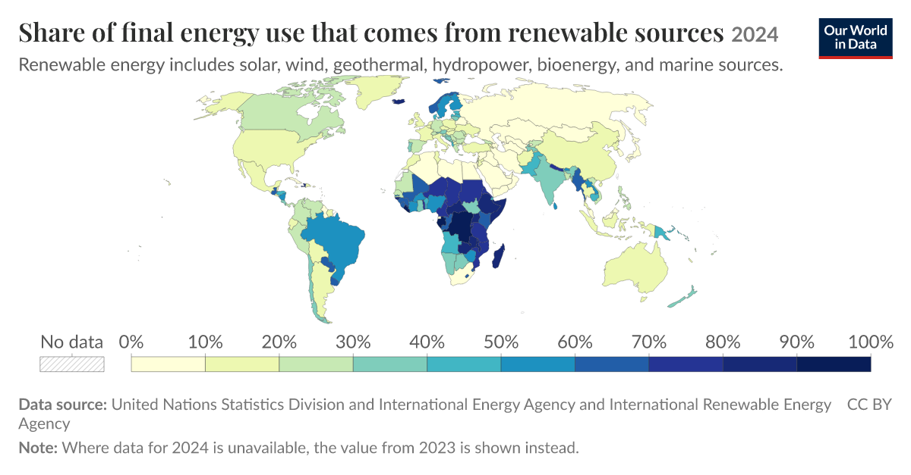

```{r setup, include=FALSE}
knitr::opts_chunk$set(echo = TRUE)

library(readxl)
library(stargazer)
library(ggplot2)
library(performance)
```

# *To what extent do different economic factors affect Renewable Energy Consumption?*

## Abstract ##
<br>
The study uses Ordinary Least Squares regression to examine the relationship between various economic factors and the use of renewable energy. The multivariable model achieves a slightly higher R-squared than the OLS models however model selection criteria favours the simpler log GDP per capita model. Nevertheless, diagnostic tests indicate that even the preferred model (log GDP) does not fully satisfy the assumptions of the OLS. The findings suggest that higher-income countries tend to have lower renewable energy shares in their final energy consumption, although this relationship should be interpreted cautiously. <br>

## Introduction ## 
<br>
The switch to renewable energies is a pressing global concern, given rising temperatures, climate change disasters and geopolitical instability, which all result, directly or indirectly, from reliance on fossil fuels and the consequent release of greenhouse gases (Renewable Energy Institute, 2025). <br>
<br>
 
Thus it is an important endeavour to analyse the factors which affect countries' disposition to increase their share of renewable energies. This allows policymakers to determine where policy and regulation can act to promote a higher share of renewable energy use. However, drivers of global adoption are varied and the evidence on their effect is mixed (Osińska et al., 2024). Given the scope of this project, economic factors were selected as a focus, as these are well defined and consistently measured across countries. However, it is noted that the true relationships are much more complex and also include a range of social, institutional, cultural and geographical factors (Osińska et al., 2024). <br>
<br>
 
A quick visual inspection of the global distribution of the share of renewable energies in final energy consumption illustrates this complexity. <br>
<br>


 
 
<br>
Figure 1: World map showing share of renewable energy in final energy use in 2021 (Our World in Data, 2026) <br>
<br>
 
At first glance, this does not clearly show any patterns regarding wealth, which would be expected given the substantial upfront costs of installing renewable energies (International Energy Agency, 2024). However, high-income countries across Europe and North America derive only a minority of their final energy use from renewable sources, while lower-income countries in Central and East Africa report renewable energy shares of up to 100%. This reflects that there are a variety of other factors at play, some of which will be attempted to be laid out in the following. <br>
<br>

This project therefore asks:<br>
<br>
 
To what extent are economic factors associated with the share of renewable energy in final energy consumption across countries in 2021? <br>
<br>
 
More specifically, it will be examined how gross domestic product (GDP) per capita, gross capital formation, trade openness, foreign direct investment and natural resource rents are associated with the renewable share of final energy consumption. <br>
<br>
 
World Bank data for 164 countries from the year 2021 is used, as this is the most complete and current global dataset. Relationships are estimated using ordinary least squares (OLS) regression. This is an appropriate choice of method, as the dependent variable (share of renewable energy in final energy use) is continuous and the aim is to estimate the associate of several economic factors with this variable, while holding the others constant, which allows the separate contribution of each factor to be assessed. <br>
<br>

## Literature Review & Variable Choice ## 
There has been a substantial amount of research on factors influencing renewable energy consumption (REC), examining financial, political, economic and environmental factors, such as income, energy security, trade, energy prices and regulatory systems (Osińska et al., 2024). However, studies vary considerably with the countries studied, the time period and the method, and thus findings are often inconsistent. For example, it has been shown that trade between EU-15 countries results in an increase in REC, whereas trade openness is negatively correlated with REC in Sub-Saharan Africa (ibid.). Similarly, Osińska et al. (2024), mentions several studies where income has been found to positively impact REC, whereas negative associations have been reported in other studies (Wu et al., 2022). Evidence on international capital flows and resource wealth is similarly divided, with the effects of foreign direct investment and natural resource rents found to vary by sector and type of resource (Doytch & Narayan, 2016; Wang et al., 2023). Given these inconsistencies, this project re-examines a focused set of economic factors, including GDP per capita, gross capital formation, trade openness, foreign direct investment and natural resource rents within a single time frame, across the globe. <br>
 <br>
**GDP per capita**
<br>
 
GDP per capita is chosen as the primary measure of a country's wealth and economic development. This is expected to be closely associated with REC, due to countries' differing ability to finance the energy transition. Higher-income countries may be more able to raise the necessary money for the high upfront costs of installing renewable energy technology (Ergun & Rivas, 2023). Furthermore, these countries face less pressure to direct public spending towards basic needs, leaving more resources available for investment in energy infrastructure (ibid.). Lastly, once citizen's basic needs are met, they are more likely to place greater value on environmental issues and are thus more willing to adopt and invest in renewable energy (ibid.). <br>
Therefore, it would be expected that GDP per capita is positively associated with REC. However, the evidence on this relationship is mixed. <br>
 <br>
A heterogeneous panel regression conducted on developed countries concluded that income levels support REC (Shahzad et al., 2021), while an analysis on specifically G7 countries found a negative relationship between economic growth and REC (Wu et al., 2022). In contrast to these linear relationships, a generalised least squares analysis on emerging Asian countries found a U-shaped relationship between GDP per capita and REC (Ergun & Rivas, 2023). <br>
 <br>
These findings indicate that a simple linear relationship between income and REC is unlikely across the global sample used. GDP per capita is therefore log-transformed for the following regression analysis, to account for the strong right skew of this data and reduce the influence of wealthy outliers. Subsequent residual diagnostics will determine if the transformed relationship is adequately linear. It is also possible that reverse causality is a possibility, where an increase in renewable energy shares drives economic growth (Osińska et al., 2024). Since the OLS regression cannot separate these directions, the GDP coefficient is interpreted as an association only. <br>
 <br>
 
**Gross Capital Formation** <br>
 <br>
Gross Capital Formation (as a % of GDP) is used as a measure of a country's investment rate and, by extension, its capacity to finance renewable energy technology and infrastructure. Specifically, it refers to the expenditure on acquisitions of produced or fixed assets, such as infrastructure and equipment (OECD, 2025). It is expressed as a share of GDP, so that economies of different scales can be compared. Gross capital formation is included because it is expected to impact REC, due to the aforementioned high capital intensity of installing renewable energies (International Energy Agency, 2024). Countries that invest a higher share of their output, are expected to have a more developed infrastructure, which in turn would allow for a quicker adoption of renewable energies. They would also be expected to be better positioned to build new infrastructure for renewable energy adoption (Ergun & Rivas, 2023). However, since this measure captures all forms of investment rather than being energy-specific, it has to be interpreted with caution. <br>
 <br>
As with GDP per capita, previous evidence on the effect of this variable on REC is mixed, with a study of Southern African nations suggesting a negative relationship between gross capital formation and REC (Aidoo, 2024), whereas other empirical studies have found a positive effect of gross capital formation on REC (Ergun & Rivas, 2023). <br>
 <br>


**Natural Resource Rents** <br>
<br>
Total natural resource rents (as a % of GDP) are used as a measure of a country’s natural resource wealth, estimating the value of oil, natural gas, coal, mineral and forest production at world prices, minus the costs of production (World Bank, 2016). <br>
<br>
Natural resource rents are relevant to this analysis due to the apparent “resource curse,” whereby resource-abundant economies tend to grow slower than resource-poor ones (Sachs & Warner, 2001). The same dependence on resource revenues that holds back growth may also slow the energy transition, as revenues from fossil fuels may reduce the incentive to diversify the energy mix and strengthen the position of incumbent energy industries, which would be expected to lower renewable energy consumption. Whether natural resources become a curse depends largely on the quality of a country’s institutions (Mehlum et al., 2006). <br>
<br>
Evidence on the relationship between resource rents and renewable energy consumption is more limited than for the other variables and appears to vary by type of resource. A study analysing global data from 1988 to 2021 found that natural gas and mineral rents weakened renewable energy consumption, whilst oil rents had a positive effect (Wang et al., 2023). This suggests that the components of total resource rents may work in opposite directions, so that a single coefficient could conceal opposing relationships. <br>
<br>
The composition of the measure reinforces this concern. Total natural resource rents combine fossil fuel rents with forest rents, and forest rents rise with fuelwood harvesting. Since traditional biomass such as fuelwood is counted as renewable energy (IEA, 2024), countries with high forest rents may record high renewable shares for reasons unrelated to clean energy investment, which is why Sub-Saharan Africa has the highest renewable share of any region, thus reflecting energy poverty as much as clean energy investment. Results for this variable must therfore be treated as indicative, and disaggregating rents into fossil fuels and forest components would allow this to be tested directly. <br>
<br>
**Foreign Direct Investment**<br>
<br>
Foreign direct investment (FDI) is measured as net inflows as a % of GDP, referring to investment that gives a foreign investor a lasting interest in a domestic enterprise, defined as at least 10% of voting stock, and is compiled from balance-of-payments data (World Bank, 2026). <br>
<br>
FDI is selected as a variable because it is a primary channel through which foreign capital and technology can enter an economy, both of which are required for the transition to renewable energy. Wind and solar installations are capital-intensive, and much of the technical expertise behind them originates from abroad. Countries attracting higher levels of foreign investment may therefore be expected to adopt renewable energy more quickly, as multinationals transfer cleaner technology and management practices to host countries. This is known as the pollution halo hypothesis. By contrast, under the pollution haven hypothesis, firms relocate energy-intensive production to countries with weaker environmental regulation, which would be expected to lower renewable energy consumption (Eskeland & Harrison, 2003). <br>
<br>
Official FDI statistics blur the line between financial and physical investment, with funds channelled through holding companies counted in the same way as investment in factories or energy infrastructure. Damgaard et al. (2019) estimate that almost 40% of global FDI consists of succh investment in corporate shells. Since these flows have little connection to the host country’s actual economy, FDI figures may overstate the foreign capital available for renewable energy; therefore, the measure must be interpreted with caution. <br>
<br>
Previous evidence on the effect of FDI on renewable energy consumption is inconclusive. A study of manufacturing plants in Côte d’Ivoire, Mexico, Morocco and Venezuela found that foreign-owned firms are more energy-efficient and use cleaner types of energy than their domestic counterparts, consistent with the halo hypothesis (Eskeland & Harrison, 2003), whereas a study of 74 countries from 1985-2012 found that FDI tends to increase renewable energy consumption, although the size of the effect varies considerably by sector. In addition, a study of selected ASEAN countries found that FDI and governance quality increase renewable energy, while trade openness reduces it (Huang et al., 2022). Nguyen et al. (2026) identify a conditional halo effect in 50 developing countries: FDI is associated with higher emissions, but this reverses where renewable energy use is higher, suggesting that FDI’s environmental effect depends on the host’s energy mix instead of its volume. <br>
<br>
Since countries expanding their renewable capacity may themselves attract foreign investment, there is the possibility of reverse causality. Because OLS regression cannot distinguish between these directions, the FDI coefficient should only be interpreted as an association. <br>
<br>

**Trade Openness**<br>
<br>
Trade (as a % of GDP) is used as a measure of a country’s integration into international markets, referring to the sum of imports and exports of goods and services, and expressed as a share of GDP so that economies of different sizes can be compared (World Bank, 2026). <br>
<br>
Trade openness is expected to affect renewable energy consumption through three channels: the scale of economic activity; the composition of output; and the technology used in production (Grossman & Krueger. 1991). Through the scale effect, greater output raises total energy demand, which may be met largely by fossil fuels. Trade also alters the composition of output, as countries specialise according to their comparative advantage; depending on where that advantage lies, production may shift towards or away from an energy-intensive industry. Finally, openness can change the techniques of production by giving countries easier access to imported renewable energy technology, such as wind turbines and solar panels (Omri & Nguyen, 2014). However, since the ratio is mechanically higher for small re-exporting economies, it partly reflects country size rather than openness alone (Squalli & Wilson, 2011). <br>
<br>
Empirical evidence on trade openness and renewable energy consumption is extensive, but inconsistent. Using system GMM estimation on a panel of 64 countries between 1990 and 2011, Omri & Nguyen (2014) found trade openness to be one of the main drivers of renewable energy consumption. Because this method accounts for the persistence of national energy systems and for unobserved energy characteristics, it offers stronger grounds for inference than a single cross-section. Omri et al. (2015) obtained similar results using pooled OLS, fixed effects and random effects models, suggesting that the finding does not depend on the estimation method. In both studies, the proposed mechanism is technology transfer, whereby open economies gain access to infrastructure such as wind turbines and solar panels, alongside technical expertise. <br>
<br>
More recent studies, however, indicate that the effect of trade depends on a country’s level of development. Covering 186 countries over 1990-2015, Wang & Zhang (2021) found that trade raises renewable energy consumption in high- and upper-middle-income countries, but not in poorer countries, while Zhang et al. (2021) identified a strongly nonlinear relationship across 35 OECD countries. Murshed (2020) reported that greater openness increases the renewable share in low-income countries but reduces it in lower-middle-income economies, and Huag et al. (2022) found a negative effect in selected ASEAN economies, where trade expands energy-intensive industry. Institutions also appear to matter, as trade openness has been found to slow renewable deployment in less democratic countries (Chen et al., 2021). Taken together, these findings suggest that the relationship between renewable energy consumption and trade is unlikely to be uniform across a global sample. <br>
<br>

## Step 1 : Loading Data ## 

Before all we need to install the packages needed to conduct our analysis *should that go in the Intro maybe?*
```{r eval=FALSE}
install.packages("readxl")
install.packages("stargazer")
install.packages("ggplot2")
install.packages("performance")
install.packages("gvlma")
```

*"readxl" extracts the data from excel spreadsheets.* <br>
*"stargazer" and "ggplot2" are used to create plots.* <br>
*"performance" package allows to use the **model_comparison** R function.* <br>
*"gvlma" package allows to test linear model fit assumptions* <br>
We also call their libraries to load the packages. 
```{r}
library(readxl)
library(stargazer)
library(ggplot2)
library(performance)
library(gvlma)
```

Next we import the datasets we have chosen to use for our analysis. <br>
The following allow us to measure pollution : 
```{r}
Renewable_energies_dataset <- read_excel("Renewable_energies_dataset.xls")
```
While these ones are the different economic factors : 

```{r}
GDP_per_capita_dataset <- read_excel("GDP per capita dataset.xls")
Gross_Capital_Formation_percentage_of_GDP_ <- read_excel("Gross Capital Formation (percentage of GDP).xls")
Urban_population_percentage_of_total_ <- read_excel("Urban population (percentage of total).xls")
Total_natural_resources_rents_of_GDP_ <- read_excel("Total natural resources rents (% of GDP).xls")
Trade_of_GDP_ <- read_excel("Trade (% of GDP).xls")
Foreign_direct_investment<- read_excel("Foreign direct investment, net inflows (% of GDP).xls")
```

Each dataset has data for multiple years. For accuracy we chose to focus on the most recent year with the most amount of data, this proved to be the year of 2021 : 

```{r}
recentdata<-data.frame(Country = Renewable_energies_dataset$`Country Name`, 
                       Renewable_energy_consumption = Renewable_energies_dataset$`2021`)
```
```{r}
recentdata <- within(recentdata, {
              GDP_per_capita = GDP_per_capita_dataset$`2021`
              Gross_Capital  = Gross_Capital_Formation_percentage_of_GDP_$`2021`
              Urban_pop      = Urban_population_percentage_of_total_$`2021`
              Total_natural  = Total_natural_resources_rents_of_GDP_$`2021`
              Trade_GDP      = Trade_of_GDP_$`2021`
              Foreign_direct_investment= Foreign_direct_investment$`2021`
              })
recentdata <-na.omit(recentdata)
```

**Table 1 : Descriptive Statistics
```{r}
stargazer(recentdata, type="text", digits=1,
          title ="Table 1: Summary Statistics of the Variables (2021)")
```
Table 1 summarises the complete data for 164 countries in 2021.
<br>
The renewable energy share is very different from country to country, from 0% to 96.3% of total final energy consumption, with a mean of 32.3% and a standard deviation of 26.9. GDP per capita is heavily right-skewed, as its standard deviation (US$21,505) is bigger than its mean (US$15,522), and the richest country’s income is around 280 times that of the poorest. Most countries are at the lower end of the income distribution, which is why we use log GDP per capita in Table 3. <br>
For the other variables, urbanisation is fairly evenly spread (16.5% to 100%), and gross capital formation varies less than the others, with an average of 23.9% of GDP. Trade openness and natural resource rents are also right-skewed. Most countries are at middle levels, but a few small states are much higher than the rest. FDI has an extreme outlier of 413.3% of GDP, while the mean is only 6.6%. The negative minimum for gross capital formation (−15.7%) is a bit unusual and may be a data issue.<br>

```{r}
boxplot(recentdata$Renewable_energy_consumption, main="Renewable Energy Consumption", ylab="Percentage of GDP", col="blue")
boxplot(recentdata$GDP_per_capita, main="GDP per Capita", ylab="2015 Dollars", col="green")
boxplot(recentdata$Gross_Capital, main="Gross Capital Formation", ylab="Percentage of GDP", col="violet")
boxplot(recentdata$Urban_pop, main="Urban population", ylab="Percentage of Total", col="red")
boxplot(recentdata$Total_natural, main="Total natural resources rents", ylab="Percentage of GDP", col="orange")
boxplot(recentdata$Trade_GDP, main="Trade", ylab="Percentage of GDP", col="maroon")
boxplot(recentdata$Foreign_direct_investment, main="Foreign direct investment, net inflows", ylab="Percentage of GDP", col="purple")
```
<br>
**Renewable energy share :** The median is around 25%, lower than the mean of 32.3%, so the distribution is slightly right-skewed. There are no outliers. <br>
**GDP per capita :** This is the most skewed variable. Half of the countries are below about $6,000, and there are many high outliers above $45,000. <br>
**Gross capital formation :** The distribution is fairly symmetric around a median of about 23%, with a few outliers, including one negative value (−15.7%).<br>
**Urban population :** The distribution is fairly even, with a median of about 64% and no outliers. <br>
**Natural resource rents :** Most countries are close to zero (median around 2%), but there are many high outliers up to 61%. <br>
**Trade :** The median is around 75%, with a few very high outliers between 220% and 402%. <br>
**FDI :** Most countries are between 1% and 5%, with several outliers. The y-axis is limited to 0–40, so the most extreme value (413.3%) and negative values are not shown. <br>
<br>

**Overall Summary :** <br>
The boxplots support the patterns in Table 1. GDP per capita is the most skewed variable. Half of the countries have a GDP per capita below about $6,000, while many outliers reach over $100,000. Natural resource rents, trade and FDI are also right-skewed, with most countries at low levels and several high outliers. In contrast, urbanisation and gross capital formation are more evenly spread around the median. The renewable energy share has no outliers, but its median (around 25%) is lower than its mean (32.3%), so it is also slightly right-skewed.
<br>
<br>

## Step 2 : Bivariate and Logarithmic OLS ##
<br>
We choose to use the Ordinary Least Squares (OLS) regression because it is considered the Best Linear Unbiased Estimator (BLUE).

First, we look at the relationship between Renewable Energy Consumption and GPD per capita. <br>
<br>
**Table 2 : **OLS results for Renewable Energy Consumption and GDP per capita
```{r}
mod_gdp <- lm(Renewable_energy_consumption ~ GDP_per_capita, data = recentdata)
stargazer(mod_gdp, type = "text", 
          title ="Table 2: OLS results for Renewable Energy Consumption and GDP per capita")
```
The results show a negative and statistically significant relationship between GDP per capita and the renewable energy share (p < 0.01). The coefficient is −0.0004, so a $10,000 increase in GDP per capita is linked to about a 4 percentage point decrease in the renewable energy share. <br>
<br> 
We can infer that countries with higher GDP per capita tend to have lower shares of renewable energy on average. This is likely because the data includes traditional biomass like firewood, which is common in poorer countries. As countries get richer, households tend to shift from firewood to fossil fuels and electricity (Leach, 1992, p. 116).
<br>
The R² is 0.093, which means GDP per capita only explains about 9% of the variation across the 164 countries in our sample. So although the result is significant, there are probably other variables that matter more for renewable energy use. <br>

**Model Fit**<br>
<br>
It is also important to plot the relationship to visually assess the fit of the model used. <br>
**Scatter Plot**
```{r}
plot(recentdata$GDP_per_capita, recentdata$Renewable_energy_consumption,
     xlab = "GDP per Capita", 
     ylab = "Renewable Energy Consumption",
     main = "Relation between GDP per Capita and Renewable Consumption",
     col="blue")
abline(mod_gdp, col="red", lwd=2)
```
<br>
In the linear model, most countries are squeezed into the left side of the graph, below about $10,000, while only a few rich countries spread out to the right. Within this small range, the renewable energy share goes all the way from nearly 0% to over 90%, so the straight line cannot show the big change among poorer countries. The line also falls below zero at the highest incomes, which is not possible for a percentage.<br>
<br>

Visual assessment is not the most precise so we can check the validation of the linear model assumptions using the R function "gvlma" (Global Validation of Linear Models Assumptions).  
```{r, fig.width=14, fig.height=3.5, out.width="100%", message=FALSE, warning=FALSE}
gvlma(mod_gdp)
plot(check_model(mod_gdp, panel = FALSE))
```
<br>
The global test is highly significant (p-value = 0.000004) which indicates that the model probably does not satisfy the linear model assumptions overall. The skewness test (p-value = 0.000564) and link-function test (p-value = 0.000104) are also significant. This suggests that the **residuals are asymmetric** which indicates that this type of modelling may be inappropriate for this dataset. 

We can try using logarithms in the GDP per capita to increase the precision of the model.<br>
<br>
**Table 3 : **OLS results for Renewable Energy Consumption and log(GDP per capita)
```{r}
mod_log_gdp <- lm(Renewable_energy_consumption ~ log(GDP_per_capita), data =recentdata)
stargazer(mod_log_gdp, type="text", 
          title ="Table 3: OLS results for Renewable Energy Consumption and log(GDP per capita)")
```
<br>
With the log the relationship is still negative and statistically significant (p < 0.01). The coefficient is −11.091, meaning a 1% increase in GDP per capita is linked to about a 0.11 percentage point decrease in the renewable energy share. Since a 1% change is quite small, another way to see it is that when GDP per capita doubles, the renewable energy share is about 7.7 percentage points lower on average. <br>
<br>
The R² increases from 0.093 in Table 2 to 0.349, so this model explains about 35% of the variation in the renewable energy share. This is almost four times more than the linear model. We think this is because GDP per capita is very right-skewed (Table 1). The linear model assumes that every extra dollar has the same effect, but the log model looks at percentage changes in GDP instead. This fits the data better, because a small rise in income matters more for poorer countries than for rich ones.
 <br>

Again we can do a visual check with a scatter plot : 
```{r}
plot(log(recentdata$GDP_per_capita), recentdata$Renewable_energy_consumption,
     xlab = "log(GDP per Capita)", 
     ylab = "Renewable Energy Consumption",
     main = "Relation between log(GDP per Capita) and Energy Consumption",
     col="blue")
abline(mod_log_gdp, col="red", lwd=2)
```
<br>
After taking the log, the countries are spread out much more evenly, and the downward trend is easier to see. Almost all countries with a renewable energy share above 70% are at the low-income end. However, the points are still widely scattered around the line, and a few rich countries have much higher shares than the model predicts. This matches the model fit results, where the relationship is still not completely linear.<br>
<br>

And again, we check the validation of the linear model assumptions to better understand the fit of the model.
```{r, fig.width=14, fig.height=3.5, out.width="100%", message=FALSE, warning=FALSE}
gvlma(mod_log_gdp)
plot(check_model(mod_log_gdp, panel = FALSE))
```
<br>
Using the log function highly improves the model's ability to describe, and clarify the relationship between GDP per capita and usage of renewable energy it does not influence the linear assumptions which remain significantly **unsatisfied**. 
<br>
<br>
**Renewable Energy Consumption and Gross Capital Formation** <br>
**Table 4 : ***OLS results for Renewable Energy Consumption and Gross Capital Formation*
```{r}
mod_gross_capital <- lm(Renewable_energy_consumption ~ Gross_Capital, data = recentdata)
stargazer(mod_gross_capital, type="text", 
          title ="Table 4: OLS results for Renewable Energy Consumption and Gross Capital Formation")
```
Gross capital formation has no significant relationship with the renewable energy share (p > 0.1). The coefficient is very close to zero (−0.058), and the R² is only 0.0003, so investment explains almost none of the differences between countries. <br>

We can also do a visual check to understand why it isn't significant. 
```{r}
plot(recentdata$Gross_Capital, recentdata$Renewable_energy_consumption,
     xlab = "Gross Capital Formation (% of GDP)", 
     ylab = "Renewable Energy Consumption",
     main = "Relation between Gross Capital Formation and Renewable Consumption",
     col="blue")
abline(mod_gross_capital, col="red", lwd=2)
```
<br>
The regression line is almost flat. At every level of investment, from about 10% to 40% of GDP, the renewable energy share ranges from nearly 0% to over 90%, so there is no clear pattern. There is also one outlier with negative gross capital formation (around −15.7%).<br>
<br>

**Model Fit**
```{r, fig.width=14, fig.height=3.5, out.width="100%", message=FALSE, warning=FALSE}
gvlma(mod_gross_capital)
plot(check_model(mod_gross_capital, panel = FALSE))
```
<br>
The skewness test is significant (p-value = 0.000088), indicating a problem with the symmetry of the residual distribution. However, the kurtosis (p-value = 0.138), link-function (p-value = 0.884) and heteroscedasticity (p-value = 0.396) tests are not significant. This means that **skewness** is the main issue identified by the individual tests. <br>
<br>
**Renewable Energy Consumption and Urban Population** <br>
<br>
**Table 5 : ** *OLS results for Renewable Energy Consumption and Urban Population*
```{r}
mod_urban_pop <- lm(Renewable_energy_consumption ~ Urban_pop, data = recentdata)
stargazer(mod_urban_pop, type="text", 
          title ="Table 5: OLS results for Renewable Energy Consumption and Urban Population")
```
<br>
Urban population has a negative and statistically significant relationship with the renewable energy share (p < 0.01). The coefficient is −0.607, so a 10 percentage point increase in the urban population share is linked to about a 6 percentage point decrease in the renewable energy share. The R² is 0.239, which means urbanisation explains about 24% of the variation. This makes it the strongest variable after GDP per capita. One reason could be that people in cities rely less on firewood and more on electricity and fossil fuels (Barnes, Krutilla and Hyde, 2004, p. 27). <br>


**Scatter Plot**
```{r}
plot(recentdata$Urban_pop, recentdata$Renewable_energy_consumption,
     xlab = "Urban Population (% of total)", 
     ylab = "Renewable Energy Consumption",
     main = "Relation between Urban Population and Renewable Consumption",
     col="blue")
abline(mod_urban_pop, col="red", lwd=2)
```
<br>
The scatter plot shows a downward trend, but the points are widely spread. Countries with low urbanisation have very different renewable energy shares, from almost 0% to over 90%, while countries that are close to 100% urban mostly have shares near zero. <br>
<br>

**Model Fit**
```{r, fig.width=14, fig.height=3.5, out.width="100%", message=FALSE, warning=FALSE}
gvlma(mod_urban_pop)
plot(check_model(mod_urban_pop, panel = FALSE))
```
<br>
The skewness test is significant (p-value = 0.000666), suggesting asymmetric residuals like the previous instance. In contrast, heteroscedasticity (p-value = 0.168) are all acceptable at the 5% level. Therefore, the main issue identified by the function is **residual skewness** rather than heteroscedasticity.
<br>

**Table 6 : ***log of urban pop*
```{r}
mod_log_urban_pop<-lm(Renewable_energy_consumption ~ log(Urban_pop), data =recentdata)
stargazer(mod_log_urban_pop, type="text", 
          title ="Table 6: OLS results for Renewable Energy Consumption and log(Urban Population)")
```
Taking the log of urban population does not improve the model. The relationship is still negative and statistically significant (p < 0.01), with a coefficient of −30.855. This means a 1% increase in the urban population share is linked to about a 0.31 percentage point decrease in the renewable energy share. However, the R² drops slightly from 0.239 in Table 5 to 0.232. This is probably because the urban population is already fairly evenly spread (Table 1), so it does not need a log transformation like GDP does.
<br>
<br>
**Renewable Energy Consumption and Total Natural Resources** <br>
<br>
**Table 7 :**OLS results for Renewable Energy Consumption and Total Natural Resources
```{r}
mod_nat_resources <- lm(Renewable_energy_consumption ~ Total_natural, data = recentdata)
stargazer(mod_nat_resources, type="text", 
          title ="Table 7: OLS results for Renewable Energy Consumption and Total Natural Resources")
```
Natural resource rents have no significant relationship with the renewable energy share (p > 0.1). The coefficient is very close to zero (0.041), and the R² is only 0.0003, so this variable explains almost none of the differences between countries.
<br>


**Scatter Plot**
```{r}
plot(recentdata$Total_natural, recentdata$Renewable_energy_consumption,
     xlab = "Total Natural Resources (% of GDP)", 
     ylab = "Renewable Energy Consumption",
     main = "Relation between Total Natural Resources and Renewable Consumption",
     col="blue")
abline(mod_nat_resources, col="red", lwd=2)
```
<br>
Most countries have natural resource rents below 10% of GDP, and their renewable shares are spread across the full range. The line is almost flat. Among the few countries with high resource rents (above 15%), some have renewable shares close to 0%, while others have shares above 70%, so they do not follow one clear direction. <br>
<br>

```{r, fig.width=14, fig.height=3.5, out.width="100%", message=FALSE, warning=FALSE}
gvlma(mod_nat_resources)
plot(check_model(mod_nat_resources, panel = FALSE))
```
<br>
The problem here with the model is the skewdness of residuals again.
<br>
**Renewable Energy Consumption and Trade as % of GDP**<br>
<br>
**Table 8 : **OLS results for Renewable Energy Consumption and Trade as % of GDP
```{r}
mod_trade <- lm(Renewable_energy_consumption ~ Trade_GDP, data = recentdata)
stargazer(mod_trade, type="text", 
          title ="Table 8: OLS results for Renewable Energy Consumption and Trade as % of GDP")
```
Trade openness has a negative and statistically significant relationship with the renewable energy share (p < 0.01). The coefficient is −0.143, so a 10 percentage point increase in trade as a share of GDP is linked to about a 1.4 percentage point decrease in the renewable energy share. However, the R² is only 0.100, so trade explains about 10% of the variation, which is much weaker than GDP per capita or urbanisation.
<br>
<br>
**Scatter Plot**
```{r}
plot(recentdata$Trade_GDP, recentdata$Renewable_energy_consumption,
     xlab = "Total Trade (% of GDP)", 
     ylab = "Renewable Energy Consumption",
     main = "Relation between Total Trade and Renewable Consumption",
     col="blue")
abline(mod_trade, col="red", lwd=2)
```
<br>
Most countries have trade between about 25% and 150% of GDP. Countries with very high renewable shares are mostly at the lower end of trade. A few countries with extremely high trade (above 300% of GDP) have very low renewable shares, and they pull the line down. The line also falls below zero at the highest trade levels. <br>
<br>

**Model Fit**
```{r, fig.width=14, fig.height=3.5, out.width="100%", message=FALSE, warning=FALSE}
gvlma(mod_trade)
plot(check_model(mod_trade, panel = FALSE))
```
<br>
The skewness test is significant (p-value = 0.00338), indicating asymmetric residuals. However, kurtosis (p-value = 0.0978), link function (p-value = 0.0618) and heteroscedasticity (p-value = 0.515) are not significant at the 5% level. The link-function p-value is relatively close to the 5% threshold, but it does not constitute a statistically significant violation at this level. Therefore, **skewness** is the main issue identified.

We try using logarithms in this case <br>
**Table 9 :***Renewable Energy Consumption and log of trade*
```{r}
mod_log_trade <-lm(Renewable_energy_consumption ~ log(Trade_GDP), data =recentdata)
stargazer(mod_log_trade, type="text", 
          title ="Table 9: OLS results for Renewable Energy Consumption and log(Trade as % of GDP)")
```
Using the log of trade improves the model slightly. The relationship is still negative and statistically significant (p < 0.01), with a coefficient of −15.636. This means a 1% increase in trade is linked to about a 0.16 percentage point decrease in the renewable energy share. The R² increases from 0.100 in Table 8 to 0.117. This makes sense because trade is right-skewed (Table 1), but the improvement is small, and trade still explains much less of the variation than GDP per capita or urbanisation.
<br>

**Scatter Plot**
```{r}
plot(log(recentdata$Trade_GDP), recentdata$Renewable_energy_consumption,
     xlab = "log(Total Trade as % of GDP)", 
     ylab = "Renewable Energy Consumption",
     main = "Relation between log(Total Trade) and Renewable Consumption",
     col="blue")
abline(mod_log_trade, col="red", lwd=2)
```
<br>
After taking the log, countries are spread out more evenly, and the very high trade countries no longer pull the line as much. However, there is now one country on the far left with very low trade and a high renewable share, which has a strong effect on the left end of the line. The points are still widely scattered, which explains why the R² is only slightly higher. <br>
<br>

**Model Fit**
```{r, fig.width=14, fig.height=3.5, out.width="100%", message=FALSE, warning=FALSE}
gvlma(mod_log_trade)
plot(check_model(mod_log_trade, panel = FALSE))
```
<br>
The global test is significant, meaning that the model still does not satisfy all the assumptions jointly. The skewness test remains significant (p-value = 0.00377), while kurtosis (p-value = 0.194), link function (p-value = 0.531) and heteroscedasticity (p = 0.605) are acceptable. Compared with the model using untransformed trade, the logarithmic transformation improves the link-function result. However, the skewness problem remains, and the global test still rejects the overall assumptions.
<br>
**Renewable Energy Consumption and Foreign direct investment**<br>
<br>
**Table 10 :** OLS results for Renewable Energy Consumption and Foreign direct investment
```{r}
mod_foreign_investment <- lm(Renewable_energy_consumption ~ Foreign_direct_investment, data = recentdata)
summary(mod_foreign_investment)
stargazer(mod_foreign_investment, type="text", 
          title ="Table 10: OLS results for Renewable Energy Consumption and Foreign direct investment")
```
FDI has no significant relationship with the renewable energy share (p > 0.1). The coefficient is close to zero (−0.072), and the R² is only 0.008, so FDI explains less than 1% of the variation between countries.<br>

```{r}
plot(recentdata$Foreign_direct_investment, recentdata$Renewable_energy_consumption,
     xlab = "Foreign direct investment", 
     ylab = "Renewable Energy Consumption",
     main = "Relation between Foreign direct investment and Renewable Consumption",
     col="blue")
abline(mod_foreign_investment, col="red", lwd=2)
```
<br>
To see how much the FDI outlier affects the result, we plotted the FDI model again without the country with FDI of 413.3% of GDP. Without this point, the countries are spread across a much smaller range, and there is still no clear pattern between FDI and the renewable energy share. This suggests that the trend in the original plot was mainly caused by this one outlier.
<br>

**Model Fit**
```{r, fig.width=14, fig.height=3.5, out.width="100%", message=FALSE, warning=FALSE}
gvlma(mod_foreign_investment)
plot(check_model(mod_foreign_investment, panel = FALSE))
```
<br>
Skewness is still the main issue identified by the validation test. Although, the model has very little explanatory power.
<br>

## Step 3 : Multivariable models and model selection ##

Finally, we are going to do a multivariate OLS *explain why*
```{r}
mod_multiple <-lm(Renewable_energy_consumption ~ 
               log(GDP_per_capita) +
               Urban_pop + 
               Gross_Capital + 
               log(Trade_GDP) + 
               Total_natural +
               Foreign_direct_investment , 
               data = recentdata)
stargazer(mod_multiple, type="text", 
          title ="Table 11: Multivariable OLS results for Renewable Energy Consumption and the other variables")
```
This table includes all the variables in one model, so we can see the effect of each factor while holding the others constant. Only log GDP per capita stays significant (p < 0.01). Its coefficient is −9.636, which means a 1% increase in GDP per capita is linked to about a 0.10 percentage point decrease in the renewable energy share, holding the other variables constant. If GDP per capita doubles, the renewable energy share is about 6.7 percentage points lower. This is close to the result in Table 3 (7.7 percentage points), so the effect of GDP stays fairly stable after adding the other variables. <br>
<br>
Urbanisation and trade were both significant on their own (Tables 5 and 9), but they are no longer significant here (p > 0.1). This suggests that part of their effect in the single-variable models was actually picking up the effect of GDP, since richer countries also tend to be more urban. Gross capital formation, natural resource rents and FDI are still not significant. <br>
<br>
The model as a whole is significant (F = 15.77, p < 0.01). The R² is 0.374, but the adjusted R² is 0.351, only slightly higher than 0.345 for the log GDP model in Table 3. This means adding five more variables barely improves how well the model explains the renewable energy share. <br>

**Model Fit**
```{r, fig.width=14, fig.height=3.5, out.width="100%", message=FALSE, warning=FALSE}
gvlma(mod_multiple)
plot(check_model(mod_multiple, panel = FALSE))
```
<br>
The global test is highly significant (p-value = 0.00000145) which shows that the multiple regression does not satisfy the assumptions jointly. The skewness test (p-value = 0.000576) is significant, suggesting asymmetric residuals. The kurtosis (p-value = 0.344) and heteroscedasticity (p-value = 0.662) tests are not significant. Therefore, despite having the highest R² among our models, the multiple regression model still presents some assumption violations.

Comparing the models we have 
```{r}
model_comparison <- compare_performance(mod_gdp, mod_log_gdp, mod_gross_capital, mod_urban_pop, mod_log_urban_pop, mod_nat_resources,
                                        mod_trade, mod_log_trade, mod_foreign_investment, mod_multiple, rank = TRUE)
print_md(model_comparison)
```
<br>
To choose our final model, we compared all ten models using R², adjusted R², RMSE, AIC and BIC. The log GDP model ranked first, with a performance score of 97.4%, followed by the multivariable model (61.7%) and the urbanisation model (36.7%). The models for gross capital formation, natural resource rents and FDI ranked last, with scores close to 0%. <br>
<br>
The multivariable model has a slightly higher adjusted R² than the log GDP model (0.351 compared with 0.345), but AIC and BIC both penalise models with more variables. Since adding five extra variables only improves the fit a little, the simpler log GDP model is preferred. <br>
<br>
Even so, the log GDP model has an RMSE of about 21.7, which means its predictions are still off by around 22 percentage points on average. So GDP explains an important part of the differences between countries, but about 65% of the variation remains unexplained.<br>
<br>
**Radar Chart**
```{r}
par(mfrow = c(1, 1))
plot(model_comparison)
```
<br>
The radar chart shows the same comparison visually. Each axis is one performance measure, and points further from the centre mean better performance. The log GDP model has the largest area and performs well on every measure, so it fits the data best overall. The multivariable model does about as well on R², adjusted R², RMSE and sigma, but it is close to zero on the AIC and BIC weights, which shows that its extra variables are not worth the added complexity. Among the other single variable models, urbanisation performs best, followed by trade and linear GDP. The models for gross capital formation, natural resource rents and FDI stay close to the centre on every measure, so they fit the data worst.

## Conclusion ##
<br>
**On Model Fits**
The "gvlma()" results show that all nine models for which we have test results fail the global validation test at the 5% significance level. The most consistent problem is skewness : every model has a significant skewness test. This suggests that the residual distributions are not sufficiently symmetric.

The log GDP model, which performs best among the simple regressions in terms of explanatory power, still fails the global validation test. Similarly, the multiple regression has a higher R² but also fails the global test. Therefore, we learned that we should not select a model based only on R², adjusted R² or statistical significance.

Overall, the log GDP model remains a useful choice for a relatively simple description of the relationship between income and renewable energy consumption, but its results must be interpreted with caution because the assumptions are not fully satisfied. Further investigation of the residual distribution and functional form would be necessary before relying strongly on conventional OLS inference. These tests also do not assess every possible regression concern, such as independence of observations or omitted-variable bias ; which show up only in an in-depth analysis. 
<br>
<br>
**Limitations** 
<br>
A large limitation of this analysis is that all countries were pooled into a single cross-sectional model, regardless of income and development status. This assumes that the association between economic factors and renewable energy use is the same in every country across the world, which does not reflect the true complexity of the interactions between development, investment and resource use. In fact, the inconsistent findings across previous research may be partly explained by the fact that studies have focused on different groups of countries. Osińska et al. (2024) illustrate a more robust approach, where countries are disaggregated according to the Human Development Index. They find that the determinants of renewable energy consumption differ substantially between groups of countries that are at different levels of human development. The results from this analysis therefore represent average associations across a highly diverse sample, which may hide more complex relationships within the sample. Therefore, following Osińska et al. (2024), future models should group countries by income level, Human Development Index or similar development indicators, in order to analyse finer variations within these groups. <br>
 <br>
Furthermore, because the analysis uses data from only one year, the results only indicate association and no conclusions regarding causal links can be drawn. Time lags also cannot be captured, which may be an issue for the explanatory power of gross capital formation, as investment in new renewable capacity may take some time to affect energy consumption. Thus, in order to evaluate effects over time, as well as lagged impacts, future research could use panel data spanning several years. <br>
 <br>
In addition, the measurement of the dependent variable is problematic, due to the nature of the available dataset. The World Bank's share of renewable energy in final energy consumption counts biofuels such as charcoal and wood as renewable energy (World Bank, 2015). In many developing countries these fuels account for a large share of final energy consumption, and thus the share of renewable energy used in these countries may be inflated (International Energy Agency, 2026). It is thus more likely to reflect energy poverty than progress towards a sustainable energy transition. Future research should therefore assure that the dependent variable is restricted to modern renewables such as solar, wind, hydropower and geothermal energy. <br>
 <br>
Lastly, future research could examine the interaction of socio-cultural factors, such as environmental awareness, with the economic factors studied here, to give a more complete picture of the drivers behind renewable energy adoption. <br>
<br>
2021 year falls in the post-COVID recovery, where trade volumes and FDI flows were still volatile, and commodity prices were rising from their 2020 lows. Thus, resource rents in 2021 may differ from their long-run levels. <br>

**References** <br>
<br>
Aidoo, L. (2024). Examining the determinants of renewable energy consumption in the southern African power pool. Managing Global Transitions, 22(2). https://doi.org/10.26493/1854-6935.22.121-142 
<br>
Ergun, S. J., & Rivas, M. F. (2023). Does higher income lead to more renewable energy consumption? Evidence from emerging-Asian countries. Heliyon, 9(1), e13049. https://doi.org/10.1016/j.heliyon.2023.e13049
<br>
International Energy Agency. (2024). Reducing the cost of capital: Strategies to unlock clean energy investment in emerging and developing economies. In International Energy Agency Reports. International Energy Agency. https://www.proquest.com/docview/3146999884
<br>
International Energy Agency. (2026). Africa – Energy Mix. IEA. https://www.iea.org/regions/africa/energy-mix
<br>
OECD. (2025). Investment (GFCF). OECD. https://www.oecd.org/en/data/indicators/investment-gfcf.html
<br>
Osińska, M., Khan, A. M., & Kwiatkowski, J. (2024). Identifying economic factors of renewable energy consumption—A global perspective. Energies, 17(15), 3715. https://doi.org/10.3390/en17153715
<br>
Our World in Data. (2026). Share of final energy use that comes from renewable sources. Our World in Data. https://ourworldindata.org/grapher/share-of-final-energy-consumption-from-renewable-sources
<br>
Renewable Energy Institute. (2025). Renewable Energy Insights - The Importance of Renewable Energy for the Future. The Renewable Energy Institute. https://www.renewableinstitute.org/the-importance-of-renewable-energy-for-the-future/
<br>
Shahzad, U., Radulescu, M., Rahim, S., Isik, C., Yousaf, Z., & Ionescu, S. (2021). Do Environment-Related Policy Instruments and Technologies Facilitate Renewable Energy Generation? Exploring the Contextual Evidence from Developed Economies. Energies, 14(3), 690. https://doi.org/10.3390/en14030690
<br>
World Bank. (2015). Metadata. Worldbank.Org. https://databank.worldbank.org/metadataglossary/sustainable-energy-for-all/series/3.1_RE.CONSUMPTION
<br>
Wu, H., Mentel, U., Lew, G., & Wang, S. (2022). What drives renewable energy in the group of seven economies? Evidence from non-parametric panel methods. Economic Research-Ekonomska Istraživanja, 36(1), 1708–1734. https://doi.org/10.1080/1331677x.2022.2092525
<br>


